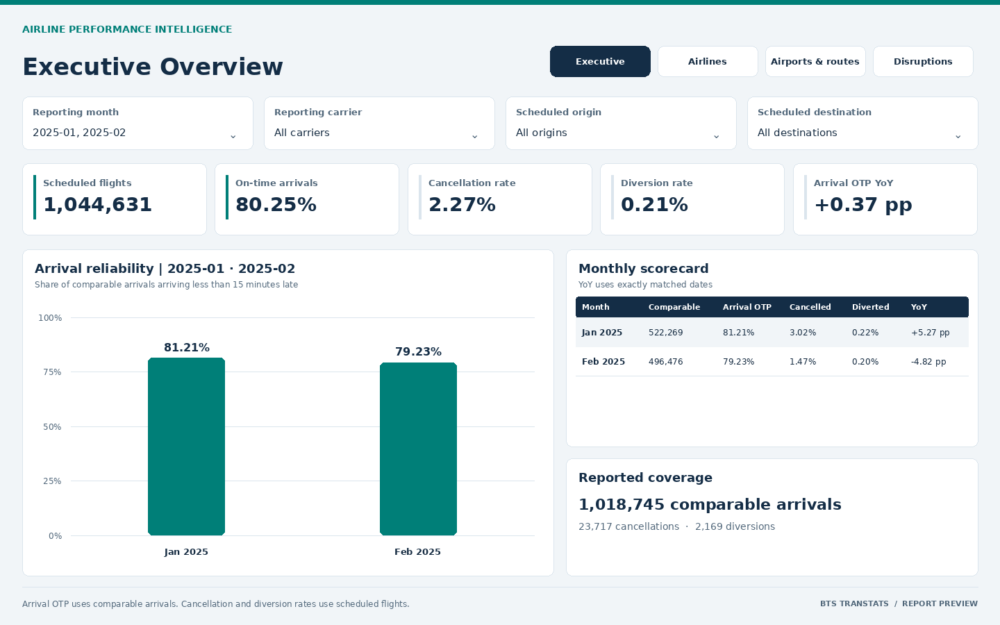

# Airline Performance Intelligence

A Power BI portfolio project for investigating airline reliability. It covers **2,111,123 scheduled flight segments** reported to the U.S. Bureau of Transportation Statistics (BTS) in January–February 2024 and January–February 2025.



*Report preview rendered from the reconciled BTS data.*

## The analysis

Airline operations teams need to see where reliability is changing and which flights warrant investigation. The report starts with a network overview and narrows the view by carrier, airport, directional route, or individual flight.

| Report page | Question it answers |
|---|---|
| Executive Overview | How are arrival reliability, cancellations, and flight volume changing? |
| Airline Benchmarking | How does a carrier compare with the selected network, given the number of eligible arrivals? |
| Airport and Route Analysis | Which airports and directional routes have the highest delay burden? |
| Delay and Cancellation Investigation | Which categories account for the reported delay minutes and cancellations? |

**Finding.** Arrival on-time performance was **80.25%** in Jan–Feb 2025 and **2.27%** of scheduled flights were cancelled. The monthly trend reveals where to investigate. January's on-time rate increased from **75.94% to 81.21%** year over year, while February's declined from **84.08% to 79.23%**. These are the reported rates for each calendar month. The [findings](docs/05-findings.md) explain the investigation priorities, and the [reconciliation](docs/monthly-reconciliation.csv) includes the denominators.

## Model and measurement

- **Power Query** reads the monthly BTS CSVs, preserves signed delay values and missing-value semantics, and derives consistent arrival and departure outcomes.
- **Star schema** with one row per scheduled flight segment and six active lookup relationships. Separate origin and destination airport tables support direction-specific filtering.
- **47 DAX measures** cover reliability, delay burden, network comparisons, and time intelligence. Report interactions include drill-through, tooltips, synced filters, and bookmarks.
- **Sample carrier-level RLS** demonstrates how a role maps a test identity to authorized carriers.

**Arrival OTP** is the share of eligible arrivals whose delay was **less than 15 minutes**. The denominator is non-cancelled, non-diverted segments with an observed arrival delay. Cancellation and diversion rates use all scheduled flights. [KPI dictionary](docs/kpi-dictionary.csv) · [Star schema](docs/star-schema.png) · [DAX library](docs/measure-library.dax)

## Run locally

Use 64-bit Power BI Desktop on Windows and Python 3.11 or later. From the repository root, with Power BI Desktop closed:

```powershell
python scripts/fetch_bts.py
python scripts/prepare_desktop.py --launch
```

The first command downloads four official BTS archives, verifies their SHA-256 values, and extracts the CSVs to `data/raw`. Allow about 1 GB for the extracted source files. The second command configures the model's local data folder and opens the project.

Select **Home > Refresh** to load the data. With filters cleared, **Scheduled Flights** should show **2,111,123**. Open `power-bi/Airline Performance Intelligence.pbip` manually if the file association does not launch Power BI. [Manual setup and Power Query guide](docs/02-power-query.md)

The [acceptance query](docs/desktop-acceptance.dax) can be run in DAX Query View after refresh. Compare it with the [manual fixtures and validation guide](docs/04-validation.md). For a walkthrough, filter to Feb 2025 in Executive Overview, then follow a route into **Flight Records**. [Report interactions and role testing](docs/03-report-and-security.md)

## Repository guide

| Folder | Contents |
|---|---|
| `power-bi/` | PBIP entry point, TMDL semantic model, and PBIR report definitions |
| `power-query/` | Readable M queries for studying the ETL |
| `docs/` | Business requirements, measures, source checksums, star schema, data audit, validation, and findings |
| `previews/` | Images of the four report pages |
| `scripts/` | Data download, Desktop setup, independent profiling, and preview generation |

[Airline Benchmarking preview](previews/02-airline-benchmarking.png) · [Airport and Route Analysis preview](previews/03-airport-and-route-analysis.png) · [Disruption Investigation preview](previews/04-delay-and-cancellation-investigation.png)

## Data source and scope

U.S. DOT Bureau of Transportation Statistics, **Reporting Carrier On-Time Performance (1987–present)**. The [project manifest](docs/source-manifest.csv) identifies the four official archives and their SHA-256 checksums. Interpret findings within those months and reporting carriers. Delay and cancellation reasons are carrier-reported categories. [BTS TranStats](https://www.transtats.bts.gov/ontime/) · [BTS field definitions](https://www.transtats.bts.gov/Fields.asp?gnoyr_VQ=FGJ)
