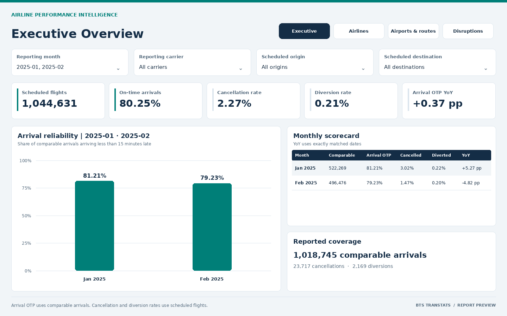

# Airline Performance Intelligence

A Power BI portfolio project analyzing 2,111,123 U.S. flight segments to explore arrival reliability, delays, and cancellations.

[View the project documentation and setup guide](01-upload-first/README.md)
